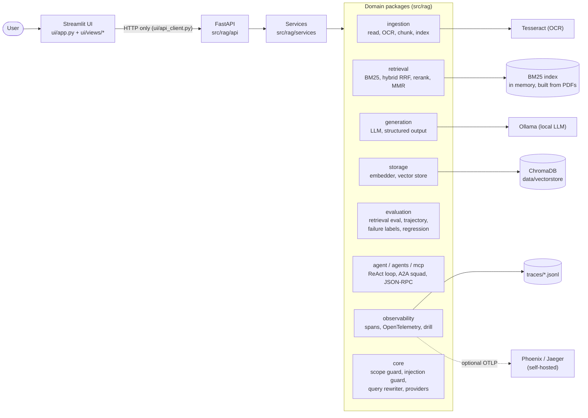
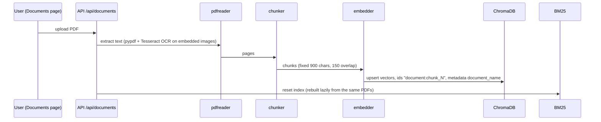
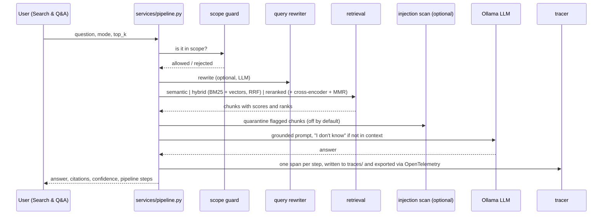

# Architecture

An insurance policy and claims assistant: upload policy PDFs, ask questions and get cited answers, triage claims with agents, and inspect, evaluate and trace everything from one UI. It covers the Week 1-12 curriculum as one application, with open-source tooling throughout.

- [Setup](setup.md) · [Features](features.md) · [Legacy index](legacy.md) · [Weekly notes](weekly/README.md) · [Technical reference](technical-reference.md)

## System at a glance

Rules the code follows:

1. **The UI never imports backend code.** It only calls the HTTP API through `ui/api_client.py`.
2. **One place per capability.** Anything superseded lives in `legacy/` (see [legacy.md](legacy.md)).
3. **Swap the implementation, not the call sites.** Vector storage sits behind `storage/vectorstore.py`; tracing sits behind the existing `Span` / `RequestTrace` classes.
4. **No secrets in code.** Settings come from `.env` (see [setup.md](setup.md)).

## Data flow

### Ingestion (upload or re-index)

On first start with an empty vector store, the API indexes everything in `resources/` in the background (`ingestion/indexer.py: bootstrap_if_empty`). The System page shows progress.

### Question answering (`POST /api/ask`)

If the LLM is not running, retrieval and citations still work and the answer says so plainly.

## Package map

| Package (`src/rag/`) | Responsibility | Notes |
|---|---|---|
| `api/` | FastAPI app, one router per area | `main.py` registers 12 routers and runs startup bootstrap |
| `services/` | Orchestration the API calls | pipeline, agents, MCP, multi-agent, cache, observability, evaluation, foundations, error analysis, health, capstone |
| `ingestion/` | PDF reading (pypdf + OCR), chunking (fixed / keyword / semantic), indexing | moved from `core/ingest` and `scripts/dataprocessor` |
| `retrieval/` | BM25, hybrid search (RRF), cross-encoder reranker, MMR | moved from `core/retrieval` |
| `generation/` | Grounded LLM answer (`llm.py`), structured output with validation and retry (`structured.py`) | moved from `infra/llm` |
| `storage/` | Embedder and the ChromaDB vector store | moved from `infra/` |
| `evaluation/` | Retrieval metrics, trajectory scoring, failure labelling, regression cases | gathers what was spread over `scripts/`, `agent/`, `services/` |
| `core/` | Scope guard, prompt-injection guard, query rewriter, provider interfaces, document ids | |
| `agent/`, `agents/`, `mcp/` | Single ReAct-style agent with budgets; manager + two specialists over A2A envelopes; JSON-RPC MCP servers and host | |
| `observability/` | `tracer.py` (spans, PII redaction), `otel.py` (OpenTelemetry bridge), `support_drill.py` | |
| `cache/` | Semantic cache and its benchmark | |
| `models/` | Pydantic request and response schemas | |
| `config.py` | All settings and paths | reads `.env` |

## Technology choices

| Concern | Tool | Why |
|---|---|---|
| Vector store | **ChromaDB** (embedded, persistent, cosine HNSW) | Named in the Week 3 brief. Needs no account or API key and works offline. Replaced the hosted Pinecone service. |
| Tracing | **OpenTelemetry SDK** | Named in the Week 11 brief. Real trace and span ids and a standard export path (JSONL file always; OTLP/HTTP to self-hosted Phoenix or Jaeger if configured). Replaced a hand-rolled span class that was only "OTel compatible". |
| OCR | **Tesseract** via pytesseract | Already open source; no change. |
| Embeddings | sentence-transformers `all-MiniLM-L6-v2` (384 dims) | Already open source; configurable with `EMBEDDING_MODEL`. |
| Keyword search | `rank-bm25` | Already open source. |
| Reranker | cross-encoder `ms-marco-MiniLM-L-6-v2` | Already open source; configurable with `RERANKER_MODEL`. |
| LLM | **Ollama** (`llama3.2` by default) | Local; no per-token charge. |
| API / UI | FastAPI, Streamlit | |
| Validation | Pydantic | Structured output schema and API models. |

### What changed in the open-source swap, and what was lost

| Swap | Gained | Lost or different |
|---|---|---|
| Pinecone to ChromaDB | No account, no network, no cost; data lives in `data/vectorstore/`; same `{id, score, text, metadata}` results and `$eq` filters | No managed scaling or replication; the store is single-process and embedded; vectors are not migrated from Pinecone (the index is rebuilt locally on first start, a few seconds to about 15 s for the two shipped PDFs); the old before/after numbers in `data/baseline_results.json` and `data/hybrid_results.json` were measured on a different corpus and index and cannot be reproduced |
| Custom spans to OpenTelemetry | Standard ids and exporters; spans from every `/api/ask` step | Nothing functional. Token counts remain estimates (about 4 characters per token) and cost is an illustrative hosted-price equivalent because the models run locally |

The live System page shows each tool as active or not, and its self-test performs a real round trip through each one.

## Observability

- Every `/api/ask` request produces a `RequestTrace` with spans `scope_guard`, `query_rewrite`, `retrieval:<mode>`, `generation:llm`, appended to `traces/production_traces.jsonl` (with PII redaction) and exported through OpenTelemetry to `traces/otel_spans.jsonl`. The older flat trace is still written to `traces/traces.jsonl` and feeds error analysis and trace replay.
- Set `OTEL_EXPORTER_OTLP_ENDPOINT` to also send spans to an OTLP collector.
- The Week 11 **support drill** runs on generated traces that include one planted failure. It teaches the method; it is not a finding about real traffic.

## Known limits

These are stated in the UI too (Capstone > Known weak spots):

- The "ReAct agent" runs a fixed step plan; no LLM chooses the next step, and its token and cost figures are estimates.
- The semantic-cache benchmark simulates latency and uses a fixed per-query cost; its percentage shows the mechanism, not measured savings.
- On the 12-question insurance evaluation set, reranked retrieval scored lower than hybrid. The set is small, so treat one question as noise.
- Answer generation, query rewriting, the LLM judge and live structured output need Ollama.
- The prompt-injection scanner is rule-based and off by default.
